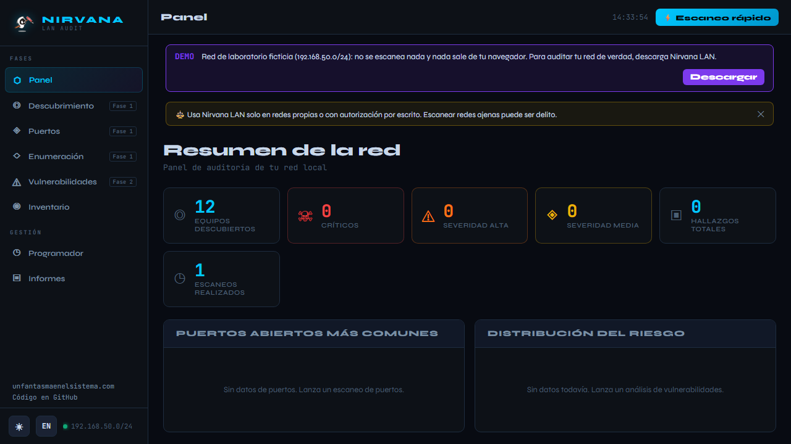
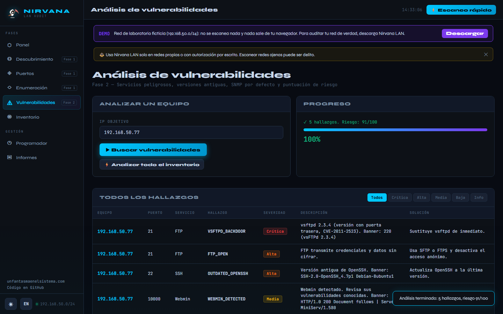

<p align="center">
  <a href="https://www.unfantasmaenelsistema.com"></a>
</p>

<h1 align="center">Nirvana LAN</h1>

<p align="center">
  <b>Auditoría de red local con interfaz web</b><br>
  Descubrimiento de equipos · Puertos y banners · DNS y SMB · Vulnerabilidades · Informes · Escaneos programados
</p>

<p align="center">
  <a href="https://unfantasmaenelsistema.github.io/NirvanaLan/"><b>▶ Probar la demo</b></a> ·
  <a href="#instalación">Instalar</a> ·
  <a href="https://www.unfantasmaenelsistema.com">unfantasmaenelsistema.com</a> ·
  <a href="LICENSE">MIT</a>
</p>

> [!IMPORTANT]
> Úsala solo en redes propias o con autorización por escrito. Escanear redes ajenas puede ser delito.



## Dos formas de usarla

| | Demo en el navegador | Herramienta local |
|---|---|---|
| Dónde | [unfantasmaenelsistema.github.io/NirvanaLan](https://unfantasmaenelsistema.github.io/NirvanaLan/) | Tu equipo (Windows, Linux o macOS) |
| Red | Laboratorio ficticio `192.168.50.0/24` con 12 equipos | Tu red real |
| Qué hace | Toda la interfaz, con escaneos simulados y las mismas reglas de detección | Ping, ARP, conexiones TCP y UDP reales |
| Datos | No se escanea nada ni sale nada del navegador | Base SQLite local en `db/` (nunca se sube al repositorio) |

Un navegador no puede hacer ping, leer la tabla ARP ni abrir sockets, así que el escaneo real necesita la parte en Python. La demo sirve para ver cómo funciona y para practicar en clase.

## Qué hace

**Fase 1 — Descubrimiento y enumeración**
- **Descubrimiento**: sondas ICMP para llenar la caché ARP, lectura de la tabla ARP (solo de la red pedida) y comprobación TCP de los que no responden al ping. Hasta /22 (1024 direcciones).
- **Identificación**: MAC, fabricante por OUI (marca las MAC aleatorias de móviles), nombre por DNS inverso y pista de sistema operativo por el TTL.
- **Puertos**: 63 habituales, 1-1000, 1-1024, completo o personalizado (`80,443,8000-8100`), con 200 hilos y captura de banners (escucha primero en SSH, FTP o SMTP y pide `HEAD` en los web).
- **DNS**: A, AAAA, MX, NS, TXT, SOA y CNAME, e intento de transferencia de zona (AXFR) con `dig`. En Windows sin `dig` usa `Resolve-DnsName`.
- **SMB**: recursos compartidos con sesión nula (`smbclient`/`rpcclient` en Linux, `net view` en Windows) y usuarios si el servidor los enumera.

**Fase 2 — Vulnerabilidades**
- Servicios peligrosos expuestos: Telnet, FTP, SMB, RDP, MSSQL, MySQL, MongoDB, Redis, Memcached, VNC, Elasticsearch, HTTP y SSH.
- Versiones antiguas por banner: Apache 2.0-2.2, OpenSSH ≤ 6, IIS 5-7, vsftpd antiguo y **vsftpd 2.3.4 con puerta trasera** (CVE-2011-2523), Webmin.
- **SNMP con la comunidad `public`**: envía un GetRequest SNMPv1 real por UDP 161 y muestra el `sysDescr` si contesta.
- Puntuación de riesgo 0-100 por equipo (crítica 40, alta 20, media 10, baja 5) y análisis de todo el inventario de 4 en 4.

**Fase 3 — Gestión**
- Inventario con buscador, ficha de cada equipo y notas.
- **Programador**: escaneos cada hora, día o semana (se ejecutan mientras Nirvana LAN esté abierto) y botón «Ejecutar ahora».
- **Informes** HTML y TXT en español o inglés, con resumen, equipos, puertos y hallazgos ordenados por severidad.
- Interfaz en español e inglés, tema oscuro y claro, y diseño adaptado a móvil.



## Instalación

Requiere **Python 3.9 o superior**.

```bash
git clone https://github.com/unfantasmaenelsistema/NirvanaLan.git
cd NirvanaLan
```

**Windows**: doble clic en `start.bat` (instala Flask y psutil y abre el navegador).

**Linux / macOS**:

```bash
./start.sh
```

O a mano: `pip install -r requirements.txt` y `python app.py`. El panel se abre en http://localhost:7777.

Opciones: `--port 8080` cambia el puerto, `--no-browser` no abre el navegador, y `--lan` publica el panel en la red, para usarlo desde otro equipo.

> [!WARNING]
> Con `--lan`, cualquiera de la red podrá usar el panel: no tiene contraseña. Por defecto solo escucha en `127.0.0.1`.

Herramientas opcionales para más detalle: `dig` (DNS y AXFR) y `smbclient`/`rpcclient` (SMB en Linux). En Debian/Ubuntu/Kali:

```bash
sudo apt install dnsutils smbclient
```

## Seguridad

- **Solo en local por defecto** (`127.0.0.1`). La API responde únicamente si la cabecera `Host` es la esperada, lo que frena el *DNS rebinding*. Las peticiones que cambian algo exigen la cabecera `X-Nirvana`, así que otra web abierta en tu navegador no puede lanzar escaneos ni borrar el inventario.
- **Nada de lo que llega de la red se interpreta como HTML**: nombres DNS, banners, recursos SMB, registros DNS y notas se escapan en el panel y en los informes, que además llevan una CSP que impide ejecutar scripts. Un equipo hostil no puede atacarte a través de Nirvana LAN.
- **Entradas validadas**: IP, redes CIDR, dominios y puertos se comprueban antes de llegar a `ping`, `dig` o `smbclient`, y no hay `shell=True`.
- **Los datos de auditoría no se suben**: `db/` y los informes están en `.gitignore`.

## Desarrollo

```
app.py                  # backend Flask: escaneos, validación, programador e informes
templates/index.html    # interfaz (sin scripts inline, compatible con la CSP)
static/js/app.js        # lógica de la interfaz
static/js/i18n.js       # textos en español e inglés
static/js/demo.js       # API simulada para la demo de GitHub Pages
scripts/build_pages.sh  # genera la demo en _site/
```

La demo usa exactamente la misma interfaz: `scripts/build_pages.sh` copia `templates/index.html` y `static/`, e inyecta `demo.js`, que sustituye las llamadas a `api/` por la red ficticia. El workflow `.github/workflows/pages.yml` la publica en cada cambio de `main`.

## Limitaciones

- Solo IPv4. El descubrimiento admite hasta /22 por escaneo.
- El TTL es solo una pista del sistema operativo (un router puede alterarlo).
- Los hallazgos por puerto abierto indican **exposición**, no vulnerabilidad confirmada: comprueba versiones y configuración antes de concluir.

---

Proyecto de [Un fantasma en el sistema](https://www.unfantasmaenelsistema.com) · Licencia [MIT](LICENSE)

<details>
<summary><b>English</b></summary>

**Nirvana LAN** is a local network audit tool with a web UI: host discovery (ICMP + ARP + TCP), port scanning with banner grabbing, DNS and SMB enumeration, vulnerability checks (dangerous exposed services, outdated versions, backdoored vsftpd 2.3.4, SNMP `public` community over real UDP), risk scoring, scheduled scans and HTML/TXT reports in Spanish or English.

Try the [browser demo](https://unfantasmaenelsistema.github.io/NirvanaLan/), which runs against a fictitious lab network and never scans anything. For real audits, install it locally with Python 3.9+ (`start.bat` on Windows, `./start.sh` on Linux/macOS). By default it only listens on `127.0.0.1`. Everything coming from the network is HTML-escaped, inputs are validated before reaching any external command, and audit data stays out of the repository. Only use it on networks you own or are authorised to test. MIT licensed.

</details>
